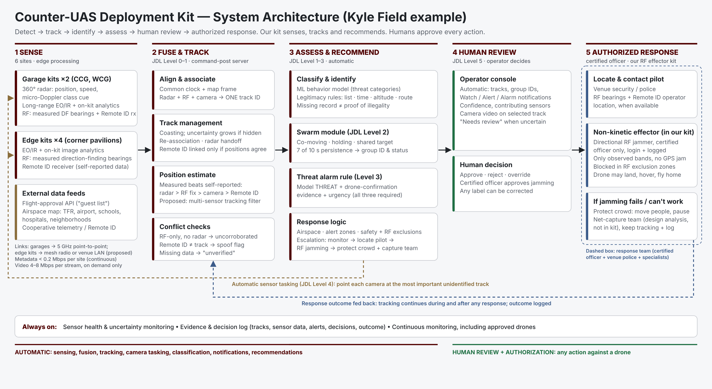

# Kyle Field Counter-UAS System Concept

Team entry for the **2026 RTX Ignite Design Challenge**: a portable detection and decision-support system for drones around Kyle Field (Texas A&M) on game day.

**Scope:** detection, tracking, assessment, recommendations and human review. The kit contains no kinetic, jamming or takeover equipment. Any action against a drone is decided and carried out by appropriately authorized external responders.



## Design at a glance

| Site | Count | Sensors |
|---|---|---|
| Garage kit: top decks of Central Campus Garage and West Campus Garage | 2 | 360° radar, long-range EO/IR camera, RF sensor |
| Edge kit: Kyle Field corner pavilion roofs | 4 | EO/IR camera, RF sensor |
| **Total** | **6 sites** | **2 radars, 6 cameras, 6 RF sensors** |

## Repository layout

| Folder | Contents |
|---|---|
| [`ML Files/`](ML%20Files) | Simulator, trained behavior model, data, studies and results. Start with [`ML Files/README.md`](ML%20Files/README.md). |
| [`CAD Files/`](CAD%20Files) | FreeCAD models (`.FCStd`) of both kits, the deployment cases, the command post kit, and Kyle Field with the kits installed, plus rendered images in `Renders/`. |
| [`Coverage Maps/`](Coverage%20Maps) | Interactive coverage viewer (download `Kyle_Field_v9_Coverage_Viewer.html` and open it in a browser), RF / camera envelope map (PNG and SVG), and the radar line-of-sight site survey image. See `README_Revised.txt` for the viewer's assumptions; the survey code is in `ML Files/site_survey/`. |
| [`3D Simulation Files/`](3D%20Simulation%20Files) | Interactive demo. Download `cuas_demo.html` and open it in Chrome. |
| [`Figures/`](Figures) | System architecture and geofenced response decision-flow figures (PNG and PDF). |

## Running the ML pipeline

```bash
cd "ML Files"
pip install -r requirements.txt
python rules_baseline.py      # rules-only alarm vs. model alarm on the test snapshots
python latency_study.py       # fusion + model timing
```

See `ML Files/README.md` for the full pipeline (case generation, simulation, training, studies and demo build), what the simulator does and does not model, and how the reported numbers were produced.

## Important caveats

- **All performance results come from simulation.** Real-world performance is unvalidated.
- Coverage figures are geometric line of sight using estimated building heights, with no terrain or trees.
- Traffic mix, drone sizes, power estimates, setup times and alert-zone sizes are design assumptions.

## AI use

We designed the system: sensor choice and placement, fusion concept, rules for identifying legitimate drones and swarms, human review and geofenced response logic. AI tools helped implement four parts from our specifications: the 3D simulation and demo website, the test cases and model training, the system architecture diagram, and the CAD models. AI also helped run calculations from methods and sources we specified and helped edit our writeup. See Section 17 of our writeup for details.
